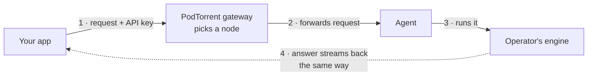

# How PodTorrent works

Three pieces work together.

The agent keeps a link open to the gateway, so the node needs no open ports.

* **The gateway** (`api.podtorrent.com`) is the only address your app talks
  to. It checks your API key, picks a node, and streams the answer back.
* **A node** is one operator's machine (or cluster) running an
  OpenAI-compatible inference engine.
* **The agent** is a small program the operator runs next to their engine.
  It keeps a link open to the gateway and passes requests through.

## What happens to one request

1. Your app sends `POST /v1/chat/completions` with a model name.
2. The gateway finds the nodes that serve that model, at a price you accept,
   with a free slot.
3. It picks the best one (see [Routing and queueing](../concepts/routing.md))
   and forwards your request unchanged.
4. The node's engine answers. The answer streams back to you through the
   agent and the gateway.
5. The gateway records token counts and timings. It never stores your prompt
   or the answer.

If every suitable node is busy, your request waits a short time for a slot
instead of failing straight away.

## Why it's built this way

* **Operators keep control.** They choose their models, how many requests to
  take at once, and their price.
* **Nodes don't need open ports.** By default the agent dials out, so it works
  behind NAT and strict firewalls.
* **Both sides keep receipts.** The node and the network each sign what they
  saw for every request. See [Receipts and billing](../concepts/receipts-and-billing.md).
